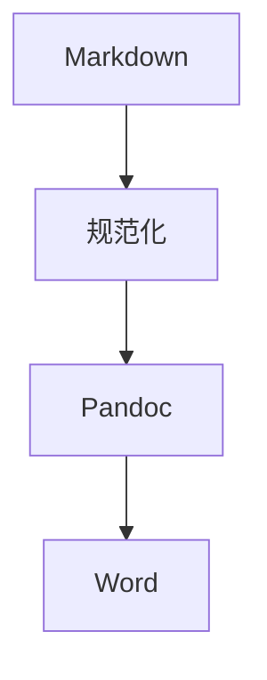

# 摘要 (Abstract)

**题目**：中文论文模板示例

**摘要**：

本文用于演示中文论文模板在 `Markdown -> Word` 技能中的内置样例能力，包括章节识别、图题、代码样式和参考文献拆分。

**关键词**：论文模板；Markdown；DOCX；Pandoc

## 第1章 绪论

### 1.1 研究背景

随着 Markdown 写作逐步普及，越来越多文档希望通过统一模板输出 Word 文稿。

### 1.2 有序列表示例

1. 整理原始 Markdown 文稿。
2. 选择合适的 Word 输出模板。
3. 执行转换并检查生成结果。

### 1.3 无序列表示例

- 支持章节标题识别。
- 支持图题与代码块示例。
- 支持参考文献按条拆分。

### 1.4 表格示例

| 项目 | 说明 | 示例值 |
| --- | --- | --- |
| 输入格式 | 原始文稿格式 | Markdown |
| 输出格式 | 最终交付格式 | DOCX |
| 转换工具 | 主转换工具 | Pandoc |

表 1-1 模板示例表

图 1-1 模板转换流程

## 参考文献

[1] Pandoc User Guide.
[2] python-docx Documentation.
[3] Mermaid Documentation.
